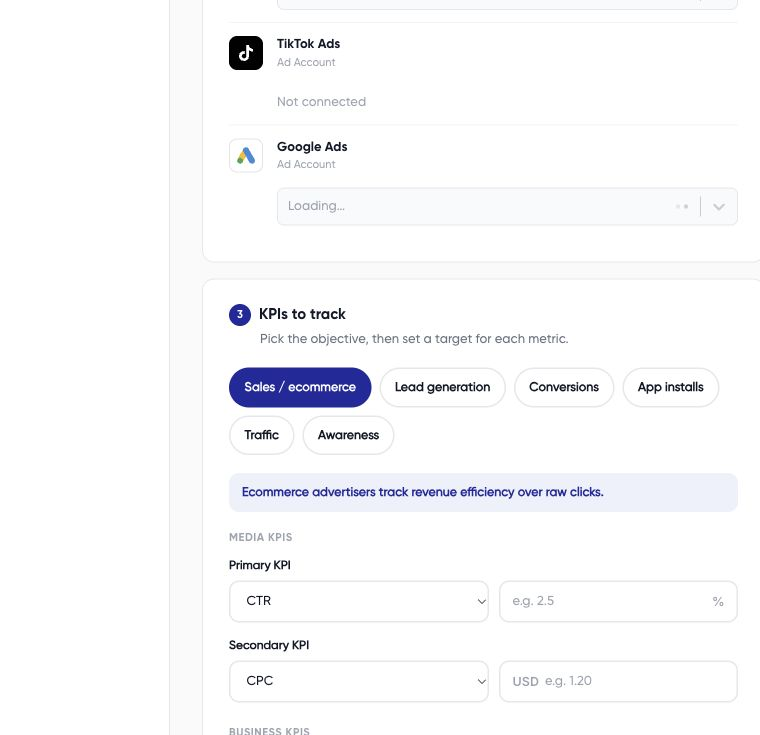

Create an advertiser group to view supported accounts together in Analytics. Connecting a platform alone does not populate the dashboard; the accounts also need a group.

## Create the group

1. Open **Settings > Advertiser groups** and choose **New group**. From the empty Analytics page, you can also follow **Create advertiser group**.
2. Enter a clear group name. Add the website and industry when relevant.
3. Check the currency displayed in the form. The inspected form uses **USD**.
4. Select the intended Meta, TikTok, and Google Ads accounts available in the form.
5. Choose the objective and review its media and business KPI fields.
6. Enter the targets with the correct units, then review and save the group using the form's action.

An account can belong to only one advertiser group according to the account-selection guidance shown in the form. If an account is unavailable, check whether it already belongs to another group.

## Choose meaningful targets

Objectives include sales/ecommerce, leads, conversions, app installs, traffic, and awareness. Changing the objective changes the KPI defaults. Choose targets that match the result your business uses, rather than keeping a default because it is already filled in.

For example, a lead-generation business might track cost per lead and lead volume. A purchase-focused business might assess purchase cost and return on ad spend. These are planning choices, not universal recommended thresholds.

## Check the result

Open **Monitor > Analytics**, select the new group, and confirm its accounts and reporting period. If Analytics remains empty, inspect group membership and connection access before adding more platforms.

Group currency is not sufficient evidence of how mixed source currencies are converted. Confirm the conversion method before relying on blended financial metrics. See [reported metric differences](/analytics/metric-differences).
