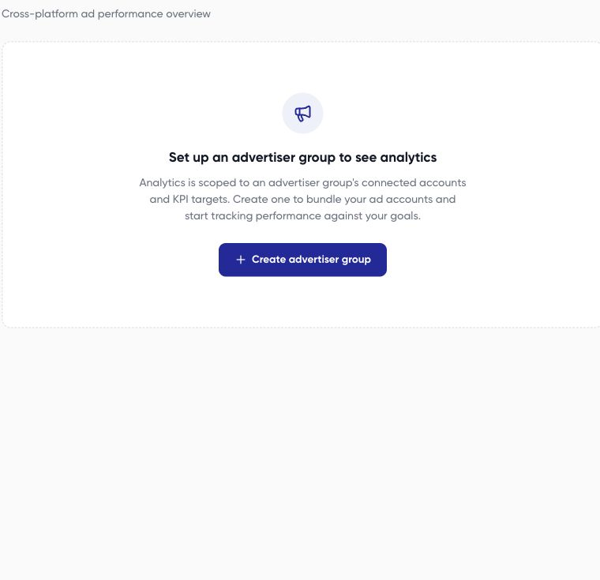

Analytics brings supported accounts in one advertiser group into a shared reporting view. Start by checking the group and date range before comparing numbers or following an alert.

<Note>
Draft for review. This guide includes steps or behavior awaiting product verification.
</Note>

## Open the right view

1. Go to **Monitor > Analytics**.
2. If you see **Set up an advertiser group to see analytics**, [create a group](/analytics/advertiser-groups) first.
3. Select the intended advertiser group.
4. Choose a date preset or custom range and use **Apply** when shown.
5. Check for missing-account or incomplete-data messages before reading totals.

## Interpret the report

The dashboard's reporting design includes summary cards for spend, revenue, blended ROAS, purchases and purchase cost, plus platform and campaign breakdowns.

| Measure | What to check |
| --- | --- |
| Spend | Accounts included, completeness, and currency handling |
| Revenue and purchases | Platform-reported conversion definitions and attribution |
| ROAS | Which revenue and spend are included in the ratio |
| Change versus a prior period | Exact comparison dates and whether both periods are complete |
| Platform comparisons | Comparable objectives, currencies, and result definitions |

Use available chart/table controls to inspect the numbers behind trends. The campaign table helps you locate the individual campaigns contributing to a result. Search for a campaign rather than inferring its performance from an account-wide total.

## Investigate before acting

Check targets in the advertiser group before interpreting performance alerts. A missing metric is different from a measured zero. If a source failed to load, treat combined totals as incomplete.

For an explanation of a specific KPI, use [Investigate KPI alerts with AI](/analytics/kpi-alerts). If Analytics and a platform dashboard disagree, follow [metric comparison checks](/analytics/metric-differences) before drawing conclusions about performance.
