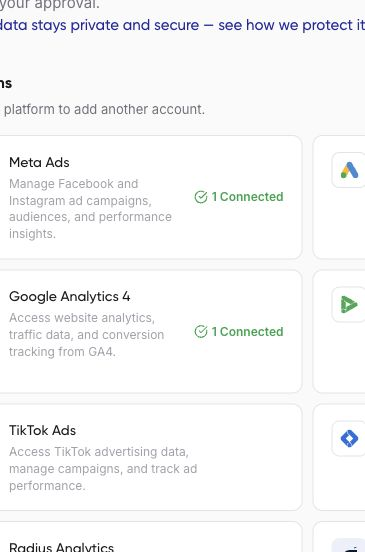

Connect HubSpot to inspect CRM records and prepare supported contact, company, deal, or ticket tasks. Confirm the correct portal before reading or changing records.

<Note>
Draft for review. This guide includes steps or behavior awaiting product verification.
</Note>

## Before you connect

Use a HubSpot identity with access to the intended portal and required objects. Define the pipeline, stage, or record properties relevant to your task.

## Connect and verify

1. In the intended workspace, open **Get started > Connect accounts** and find **HubSpot**.
2. Choose **Connect**. If the Pipedream introduction opens, review it before choosing **Continue**.
3. Complete the provider sign-in and permission screens for the intended HubSpot portal.
4. Return to Nerve and check the connection status. Use **Verify** if available.
5. Ask your assistant to list accessible HubSpot portals, then confirm the one to use.



## What to ask Nerve

The reviewed connector exposes listing, searching, reading, creating, updating, and deleting supported CRM objects. For analysis, ask for aggregate counts or selected fields first. For changes, request a record-by-record proposal and the property values that would change.

```text
Confirm the connected HubSpot portal for Example Brand. Summarize
deals in the named sales pipeline by stage and available amount.
State which date field and currency you used. Exclude personal
contact details from the summary. Do not modify any CRM records.
```

## Check scope and limits

The meaning of a CRM date or stage depends on your setup. Name the pipeline and property instead of asking for an undefined lead total. A reporting request should not include instructions to create, merge, update, or delete records. Review any generated export before sharing it.

If the expected account is missing, use [connection troubleshooting](/support-and-privacy/connection-problems). For expired access, see [Check or reconnect an account](/connections/connection-status).
