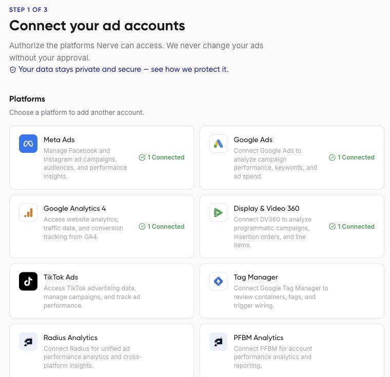
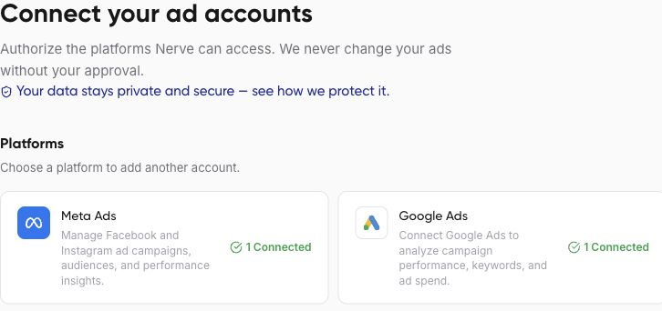

Nerve's **Connect accounts** page lists 14 integrations. Use the table below to find a platform guide and choose the right starting surface. Connection availability does not establish support for every read, write, report, or campaign format.

<Note>
Draft for review. This guide includes steps or behavior awaiting product verification.
</Note>

| Platform | Guide | Additional surface observed |
| --- | --- | --- |
| Meta Ads | [Meta Ads](/connections/meta-ads) | Chat account picker, workflow sources, advertiser groups |
| Google Ads | [Google Ads](/connections/google-ads) | Chat account picker, workflow sources, advertiser groups |
| Google Analytics 4 | [GA4](/connections/google-analytics) | Chat property picker and workflow sources |
| TikTok Ads | [TikTok Ads](/connections/tiktok-ads) | Workflow sources and advertiser groups |
| Snapchat Ads | [Snapchat Ads](/connections/snapchat-ads) | Workflow sources |
| Display & Video 360 | [DV360](/connections/dv360) | Chat account picker and workflow sources |
| Google Tag Manager | [Tag Manager](/connections/tag-manager) | Workflow sources; external tool discovery |
| Google Sheets | [Google Sheets](/connections/google-sheets) | Workflow sources; spreadsheet tools |
| HubSpot | [HubSpot](/connections/hubspot) | Workflow sources; CRM tools |
| LinkedIn Ads | [LinkedIn Ads](/connections/linkedin-ads) | External tool discovery |
| Amazon Ads | [Amazon Ads](/connections/amazon-ads) | Workflow sources; external tool discovery |
| X Ads | [X Ads](/connections/x-ads) | Workflow sources; external tool discovery |
| Radius Analytics | [Radius](/connections/radius) | Workflow sources; external tool discovery |
| PFBM Analytics | [PFBM](/connections/pfbm) | External tool discovery |

“Observed” describes a visible selection or discoverable tool, not an exhaustive availability matrix. An absent entry does not establish that the platform is unsupported there. Ask the assistant to check current tools for your task, or contact support if your platform does not appear where you need it.





## Check a specific task

```text
Check which Nerve tools are available for LinkedIn Ads reporting.
Describe the supported account and campaign breakdowns and any limits.
Do not create or update anything.
```

Some providers display a Pipedream connection handoff. Review that screen and the provider's permissions before granting access. Plan limits and platform permissions also affect what you can connect and use.
