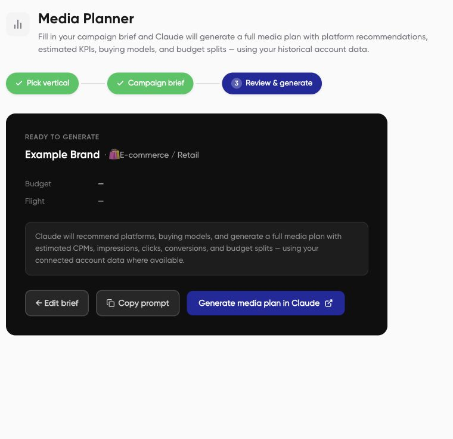

The Media planner turns your campaign brief into a prompt for an assistant. The review screen prepares the handoff; it does not itself create or launch advertising campaigns.

## Prepare your brief

Have a brand, objective, audience, markets, budget and currency, dates, and KPI target ready. Add the website and any business context that affects the plan, such as average order value, sales capacity, or a compliance requirement.

## Build the planning prompt

1. Open **Planning > Media planner**.
2. Choose a vertical: **E-commerce / Retail**, **Real Estate**, **Travel & Hospitality**, **SaaS / App**, **Finance / Insurance**, **Automotive**, **B2B / Professional Services**, or **Other**.
3. Complete the campaign basics, schedule and KPI targets, channels, and brand research fields shown for that vertical.
4. Review the brief. Check the budget currency, dates, markets, and KPI units before continuing.
5. Choose **Copy prompt** or **Generate media plan in Claude**. Set up the Nerve connection in your external assistant before asking it to use account data.

This capture shows the review layout with an incomplete example brief. Fill in the budget, dates, and targets for your actual plan. The form can allow you to continue with missing information; that does not make the brief complete.

## Worked brief example

| Field | Illustrative value |
| --- | --- |
| Brand and vertical | Example Store, E-commerce / Retail |
| Objective and market | Purchases in the UAE |
| Budget | AED 30,000 for the full campaign period |
| Dates | 1 to 30 November 2026 |
| Business inputs | Average order value AED 250; target CPA AED 50 |
| Channels | Meta and Google, subject to connected-data review |

These are example inputs, not recommended targets or a performance forecast. Channel choices in a brief do not guarantee that every format can be created through Nerve.

## Review the plan

Ask for channel allocation, audience approach, creative requirements, pacing, assumptions, and measurement. Require unsupported forecasts to be labeled as estimates. Review budget arithmetic and business targets before using [campaign setup](/campaign-management/create-paused-campaign).
