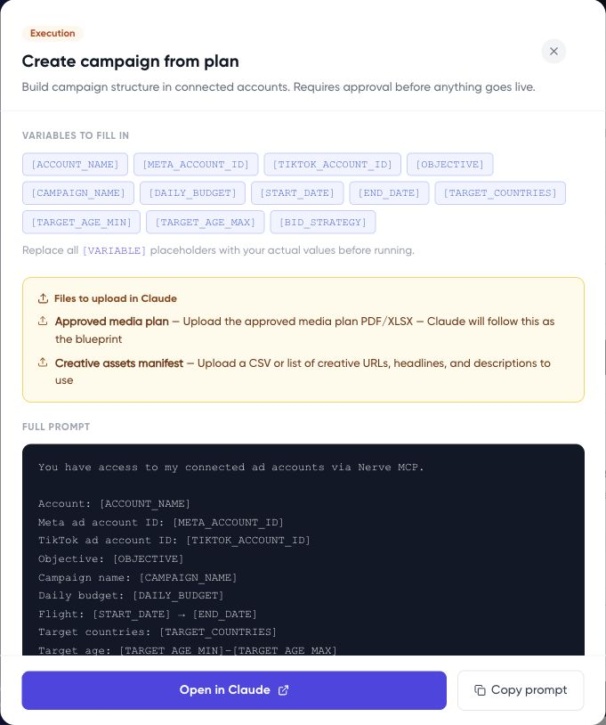

The Prompt library gives you starting instructions for common marketing tasks. Copy a prompt, replace its variables with your own details, and review what it asks the assistant to do.

## Find and prepare a prompt

1. Go to **Planning > Prompt library**.
2. Search for a task or filter by **Analysis**, **Planning**, **Execution**, or **Monitoring**.
3. Open the prompt and read the full instructions, including any file requirements and proposed actions.
4. Copy it into your chosen assistant.
5. Replace every variable token with an account, date range, target, or other value from your brief.
6. Attach any required files in the external assistant, then review and send the completed request.

The variables shown in the inspected modal are placeholders, rather than editable form fields. Replace them in the copied text. If you do not know a value, ask the assistant to clarify it rather than leaving an ambiguous token.



## Choose a task

Examples include campaign analysis, media planning, campaign creation from a plan, pacing, creative performance, audience overlap, weekly reporting, budget reallocation, campaign duplication, competitor spend estimates, and creative fatigue monitoring.

For a competitor estimate, require the assistant to label assumptions and the estimation method. Do not present inferred competitor spend as measured connected-account data.

## Add a clear operating instruction

For an analysis task, append:

```text
Use only the named accounts and period. State missing data and
assumptions. Produce recommendations only; do not change campaigns,
budgets, targeting, CRM records, or files in connected systems.
```

Execution prompts need a reviewed proposal before action. For campaign setup, follow [Turn an approved plan into a paused campaign](/campaign-management/create-paused-campaign).
