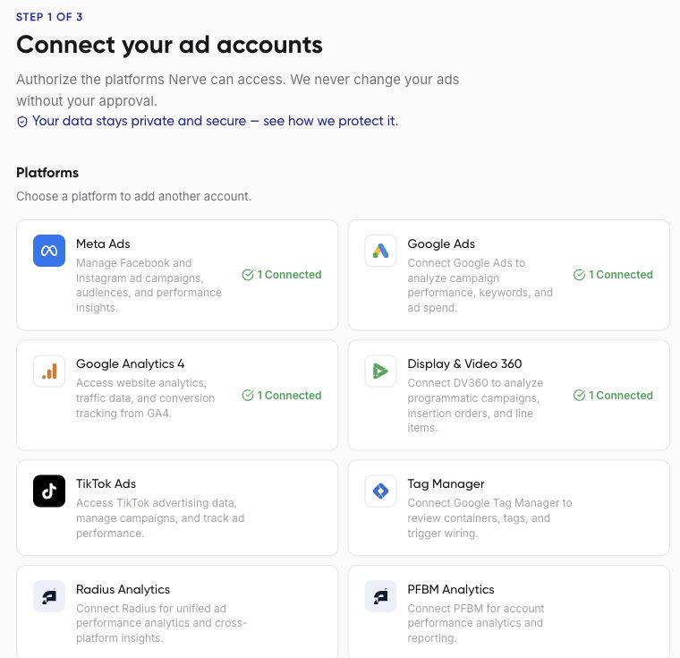
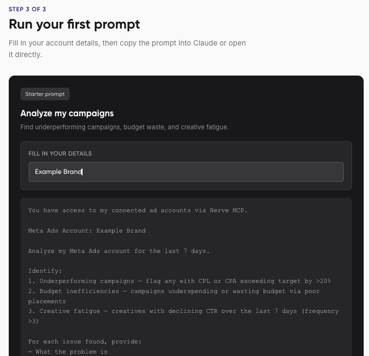

Your first successful setup is a response based on the intended account's data. Start with one platform and a small request before adding more accounts or automation.

## 1. Connect one platform

Open **Get started > Connect accounts**. Choose a platform you use, then complete its sign-in and permission screens. Check the resulting connection status and use **Verify** if available.



A connected login and an accessible advertising account are different things. You may still need to choose a customer account, advertiser, or analytics property.

## 2. Choose an assistant

Use **AI Agents > Agents** for Nerve's built-in chat. Select at least one account before sending a message. Alternatively, open **Connect to AI** and follow the [Claude](/external-ai/claude) or [ChatGPT](/external-ai/chatgpt) guide.

## 3. Make your first request

Nerve's **First prompt** page offers a Meta example. Replace the example account name before copying it. If you connected another platform, use this platform-neutral request instead:

```text
Use my connected Google Ads account for Example Brand.
First confirm the customer account you can access. Then list its
campaigns and summarize spend and clicks for the last 7 complete days.
Include paused campaigns in the listing. Do not change anything.
```



## Check the result

Confirm the account, dates, currency, and whether the assistant retrieved data or only described what it could do. Zero results need investigation: ask whether the account has no matching records, the filters excluded them, or access failed.

The Overview checklist is a setup aid. If its progress and your actual connection test disagree, inspect the connection and tool response before reconnecting. Use [connection troubleshooting](/support-and-privacy/connection-problems) if needed.
