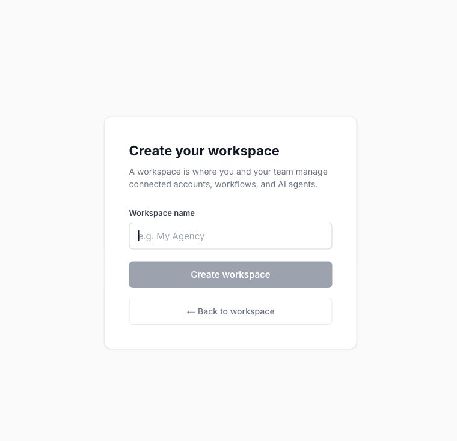

A workspace is where your team works with its connections, chats, workflows, advertiser groups, and billing. Create a separate workspace when a client or team needs a separate working area.

<Note>
Draft for review. This guide includes steps or behavior awaiting product verification.
</Note>

## Create a workspace

1. Open the workspace switcher at the bottom of the sidebar.
2. Choose the option to create a workspace. New users reach workspace creation during setup.
3. Enter a clear workspace name, such as **Example Brand**.
4. Complete the creation form, then check the workspace name in the sidebar.
5. Review **Credits & Billing** and connect the platforms this workspace needs.

The person creating the workspace is its Owner. Creating another workspace does not mean an additional free trial is available. Review the offer displayed for that workspace before continuing.

## Switch between workspaces

Open the switcher and select the workspace you want. Check its name before inviting people, adding connections, or running a workflow. Your role can differ between workspaces.

An external assistant can remain connected to a different authorization context from the workspace open in your browser. After switching clients in the app, [check your external AI connection](/external-ai/workspace-and-access) before using it for client work.

## If a workspace is missing

Confirm you signed in with the invited email, then ask an Owner or Admin to check your membership. Do not create a duplicate workspace merely because the expected one is missing.

For agency access patterns and ownership questions, see [Manage multiple workspaces and client access](/workspace-and-account/multiple-workspaces).
