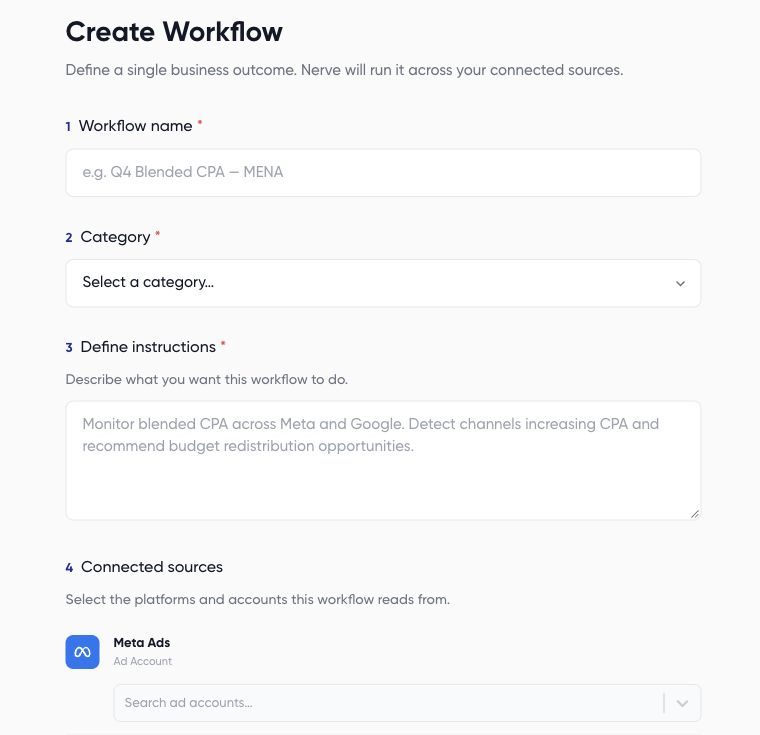

A workflow is a saved sequence of AI instructions that uses configured accounts and destinations. Start with a small read-only report so you can review the output before adding scheduling or campaign changes.

## Create a reporting workflow

1. Go to **AI Agents > Workflows** and choose **New workflow**.
2. Enter a descriptive name, such as **Weekly Example Brand review**.
3. Choose a category. Available categories include Optimization, Reporting, Pacing, Creative, Targeting, CRM Sync, and Analysis.
4. In **Define instructions**, specify the accounts, reporting periods, metrics, output, and permitted actions.
5. Under **Connected sources**, select the platform connections and intended accounts.
6. Review **Connected destinations**. Configure email only if you intend to send the output to those recipients.
7. Choose **Create workflow**, then inspect the generated steps in the builder.



## Example instructions

```text
Every run, retrieve the last 7 complete days of performance for the
selected Example Brand Meta account and the preceding 7 days.
Show spend, clicks, purchase results, currency, and missing data.
Produce a campaign table and three evidence-based recommendations.
Read only. Do not edit campaigns, update connected files, or send
email. If a configured destination conflicts with this, stop and
identify the conflict before running.
```

## Review before the first run

Read every generated step, not just the original instructions. Check source accounts and remove unintended destinations. If sources change, review the regeneration prompt and resulting steps.

Creating a workflow and running it are separate decisions. Use [Run a workflow and review results](/workflows/run-results) once the saved instructions, sources, and destinations match your goal. Add a schedule only after a useful manual test.
