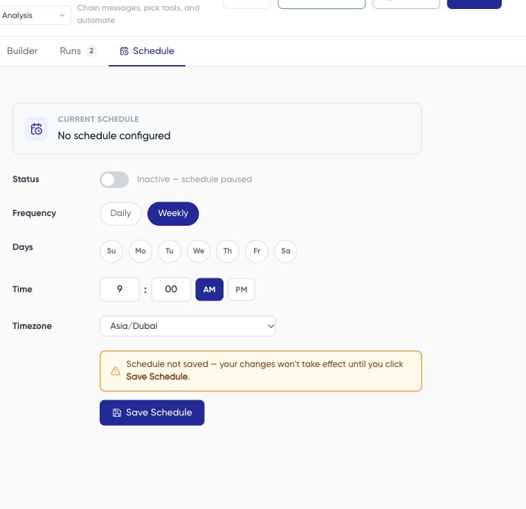

A schedule repeats a saved workflow. Review and test the task manually before enabling recurring execution, especially if any step can change data or send email.

## Configure a schedule

1. Open the intended workflow and review its saved steps, source accounts, and destinations.
2. Open **Schedule**.
3. Choose **Daily** or **Weekly**. For weekly schedules, select the intended weekdays.
4. Set the time, including AM/PM where shown, and the timezone.
5. Review the schedule status and use **Save Schedule** to persist the settings you intend.
6. Reopen the schedule to confirm the saved frequency, days, time, timezone, and status.

This capture shows an unsaved demonstration configuration with the schedule off. It does not show an enabled schedule.

## Check both states

A workflow has its own **Active** or inactive state, and its schedule has an on/off state. An active workflow with its schedule off is different from one configured for recurring execution. Read the controls rather than relying on a workflow name such as “inactive.”

Use the schedule's off setting and save it when you want to pause recurrence. Use **Deactivate** when you intend to turn the workflow itself off. After either action, reopen the relevant screen and confirm the saved state.

## Verify execution

Check **Runs** for the next expected scheduled trigger and its outcome. Inspect the actual start time and timezone rather than assuming a saved time guarantees execution at an exact minute. If a run is missing or delayed, send support the configured timezone, schedule, and run history.

Disabling a schedule is not a substitute for checking an already-running task. Use [workflow recovery](/workflows/recover-failed-run) if work is in progress.
