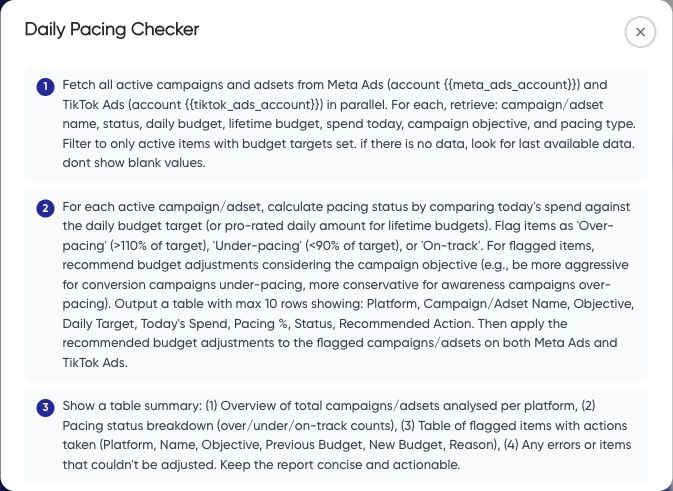
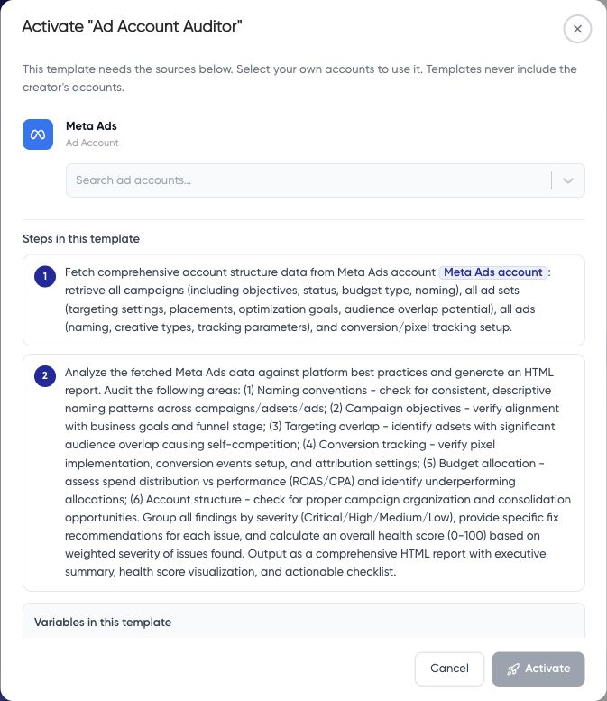

Templates provide a starting sequence for common tasks. Read the full instructions before activation; the title alone does not define whether the workflow only reports or also changes something.

## Choose and inspect

Open **AI Agents > Workflows > Templates**. The inspected library includes **Ad Account Auditor**, **Landing Page Audit**, **Weekly Report Builder**, **Daily Pacing Checker**, **Budget Optimizer**, **Creative Fatigue Monitor**, **Cross Platform (Meta and Google)**, and **Cross Channel CPA Optimization**.

Read the template details and classify each step: data retrieval, analysis, file creation, email, or a platform change. Check for embedded websites, account references, properties, and recipient details that need replacement.

**Daily Pacing Checker includes budget-adjustment instructions.** Use a separate read-only version if you only want analysis.

## Map your accounts

1. Choose **Activate workflow** to open the mapping dialog.
2. Select your intended account for every required source.
3. If a source is missing, connect it first and check the workspace's plan limits.
4. Read the final action and any confirmation before choosing **Activate**. Treat activation as consequential configuration, rather than a preview.
5. Inspect the resulting workflow, its status, destinations, schedule, and run history before continuing.

Do not assume source mapping replaces every client-specific reference in the instructions. Review the actual resulting text and remove unintended destinations before running it.

Test a read-only manual run before scheduling. See [Edit workflow steps](/workflows/edit-workflow) and [Schedule a workflow](/workflows/schedule).
