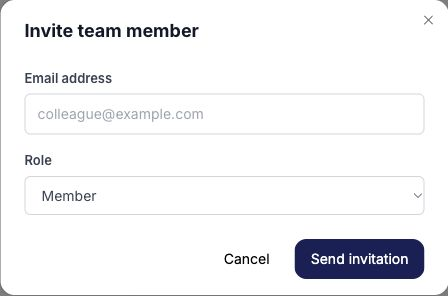

Invite people into the workspace they need and choose a role that matches their work. Workspace membership gives access to client data, so review the workspace name and recipient before sending an invitation.

## Choose a role

| Role | Intended workspace responsibilities |
| --- | --- |
| **Viewer** | Read workspace information without making workspace changes. |
| **Member** | Work with platform connections, Nerve AI chat, and workflows. |
| **Admin** | Member responsibilities plus invitations, member management, and billing. |
| **Owner** | Admin responsibilities plus changing other members' roles. |

The workspace creator is the Owner. Do not treat the role table as a substitute for checking an external assistant's permissions and authorization context. Ask support to confirm restrictions when a client requires a strictly read-only external integration.

## Send an invitation

1. As an Owner or Admin, open **Settings > Members**.
2. Choose **Invite**.
3. Enter the teammate's email address and choose **Viewer**, **Member**, or **Admin**.
4. Check the workspace, address, and role, then choose **Send invitation**.
5. Review the **Invites** tab for the invitation status.

Ask the teammate to sign in with the invited address and check the workspace switcher. If the invitation is missing, confirm its status and email before sending another.

## Change or remove access

Owners can use the member role dropdown and review the confirmation before changing a role. Owners and Admins can use the removal action for the intended member and read its confirmation. For a pending invitation, use its cancellation control if you no longer intend to grant access.

Check the current [plan limits](/billing/plans) when invitations are blocked. Review existing members and pending invitations before purchasing more capacity. For ownership transfer or externally authorized access after removal, contact support.
